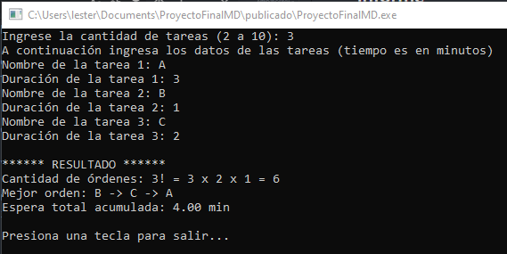
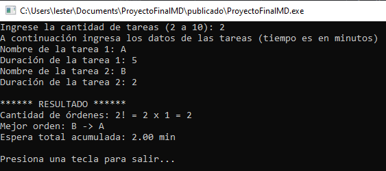
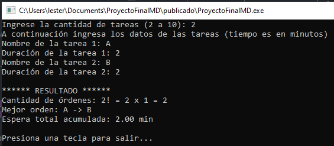
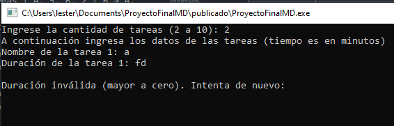

# Planificación de tareas mediante permutaciones

## Problema y aplicación
Se desea encontrar un orden de ejecución de tareas que minimice la suma de sus tiempos de espera. 

Se supone que todas las tareas están disponibles al inicio, sus duraciones son conocidas, no existen dependencias ni prioridades y cada tarea termina antes de comenzar la siguiente.

## Entradas y salidas
- Entradas: cantidad de tareas entre 2 y 10, nombre no vacío y duración positiva y finita en minutos para cada tarea.
- Salidas: cantidad de órdenes posibles expresada como factorial, mejor orden encontrado y espera total acumulada en minutos.
- Los nombres pueden repetirse, cada tarea ingresada se trata como una tarea distinta.

## Criterio de selección
La espera de una tarea es la suma de las duraciones de las tareas anteriores. La primera tarea espera cero minutos. Para cada permutación se suman las esperas individuales y se selecciona la de menor suma.

La espera total acumulada no es el tiempo que tarda en terminar el conjunto de tareas. La suma de las duraciones es igual en todos los órdenes y no sirve para elegir entre ellos.

## Procedimiento
1. Solicitar y validar la cantidad de tareas.
2. Solicitar y validar el nombre y la duración de cada tarea.
3. Generar todas las permutaciones.
4. Calcular la espera total de cada orden acumulando el tiempo transcurrido antes de cada tarea.
5. Conservar el orden cuya espera total sea menor. Si hay dos iguales, conservar el primero generado.
6. Mostrar el factorial, el orden seleccionado y su espera total.

## Algoritmo
```text
Inicio
    Ingresar y validar la cantidad de tareas.
    Ingresar nombre y duración de cada tarea.
    Generar todas las permutaciones.
    Para cada orden:
        Calcular la espera de cada tarea.
        Sumar las esperas.
    Comparar las esperas totales.
    Guardar el orden con menor espera.
    Mostrar el mejor orden y su espera.
Fin
```

## Implementación en C#
- `Job`: representa el nombre y la duración de una tarea.
- `GeneratePermutations`: genera los órdenes mediante recursión y los entrega de manera diferida con `yield return`.
- `CalculateTotalWait`: suma las esperas de un orden.
- `MinBy`: selecciona el orden con menor espera total.
- `ExplainFactorial`: presenta el cálculo de la cantidad de permutaciones.

## Ejemplo verificable
Entrada: A = 3 minutos, B = 1 minuto, C = 2 minutos.

| Orden | Esperas individuales (min) | Espera total (min) |
| --- | --- | --- |
| A → B → C | 0, 3, 4 | 7 |
| A → C → B | 0, 3, 5 | 8 |
| B → A → C | 0, 1, 4 | 5 |
| B → C → A | 0, 1, 3 | 4 |
| C → A → B | 0, 2, 5 | 7 |
| C → B → A | 0, 2, 3 | 5 |

Se evalúan 3! = 6 órdenes. El resultado esperado es B → C → A, con 4 minutos de espera total acumulada. Todas las tareas terminan en 6 minutos, esta es una magnitud distinta de la espera total.

## Casos de prueba y evidencias para el informe
| Caso | Entrada | Resultado esperado |
| --- | --- | --- |
| Orden óptimo | A: 3, B: 1, C: 2 | B → C → A; espera total 4; 6 órdenes |
| Mínimo de tareas | A: 5, B: 2 | B → A; espera total 2; 2 órdenes |
| Empate | A: 2, B: 2 | A → B; espera total 2 |
| Cantidad inválida | 1, 11 o texto | Solicitar nuevamente la cantidad |
| Nombre vacío | Espacios o cadena vacía | Solicitar nuevamente el nombre |
| Duración inválida | 0, negativo, texto, NaN o infinito | Solicitar nuevamente la duración |






## Complejidad y limitaciones
Existen n! permutaciones posibles, y evaluar cada una requiere recorrer las n tareas. Con 10 tareas se exploran 3 628 800 órdenes, lo que puede tardar bastante. Por ello, el programa muestra un aviso al inicio que recomienda un máximo de 10 tareas. Se pueden ingresar más, pero el tiempo de ejecución y el consumo de recursos crecen muy rápido.